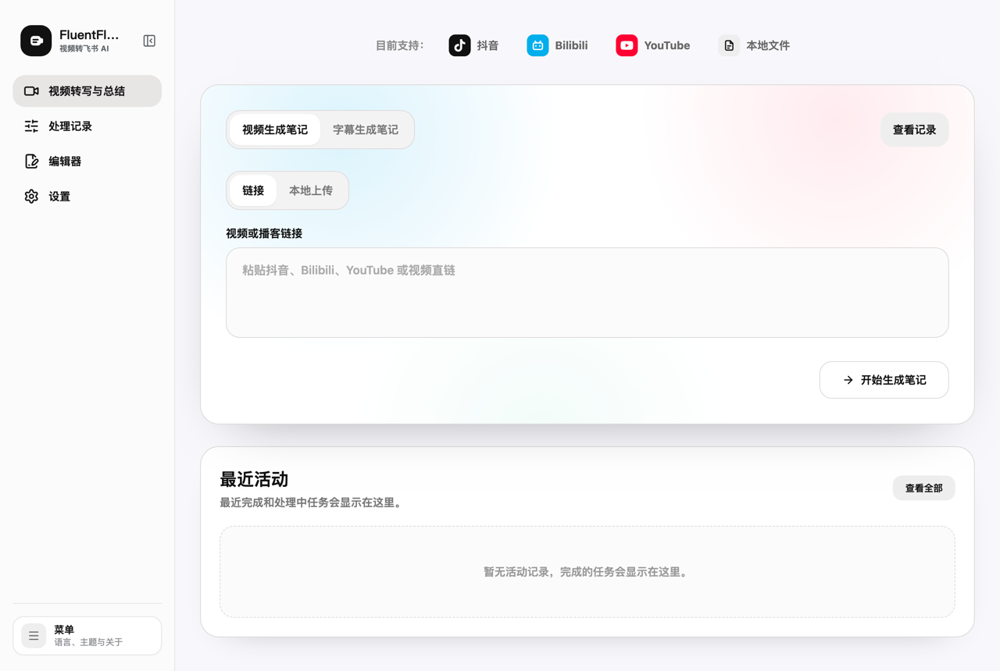
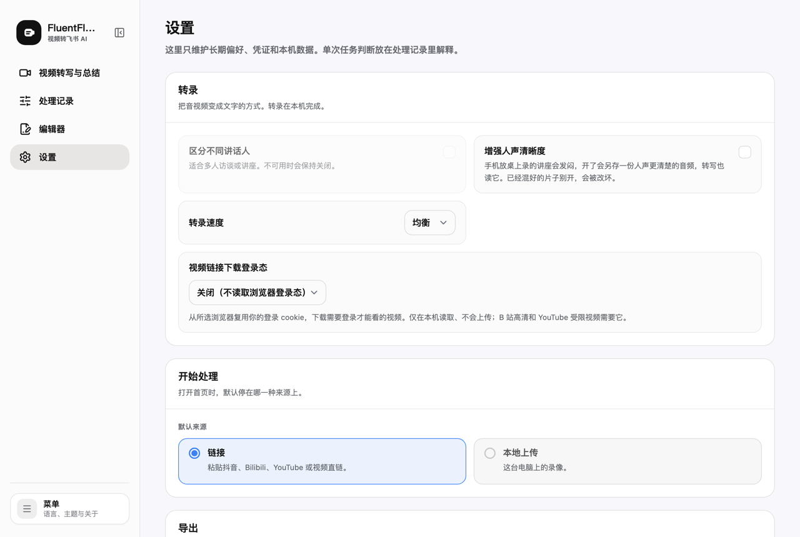

# FluentFlow Local

本地运行的视频/音频转录与笔记工具。贴一条抖音、Bilibili、YouTube 链接，或者选一个本机
文件，它把音视频转成文字，再写成一份可以编辑和导出的笔记。转录在本机完成，不上传；笔记
由你当前使用的 agent 完成；在网页上处理或明确交给后台时才使用配置的模型。飞书导出连接你配置的服务。

**最省事的装法**：把这个仓库的链接发给你的 Claude Code 或 Codex，说「帮我装上 FluentFlow」。它会按
[AGENT_INSTALL.md](AGENT_INSTALL.md) 从头装到尾，中途不需要你输密码或点任何东西。自己装也只要在终端里
运行一条命令（Windows 见 AGENT_INSTALL.md）：

```bash
curl -fsSL https://raw.githubusercontent.com/Userneima/fluentflow-local/main/install.sh | bash
```

下面是分步安装的说明，一条命令装不上时再看。



转录用的是本机的 Whisper 模型，Apple 芯片走 GPU 加速。讲话人区分、人声增强都
在设置里，处理过程中的判断会写进每个任务的记录，而不是藏在日志里。



把视频交给 Codex、Claude Code 等 agent 时，默认由当前 agent 看材料、判断剪辑、写笔记并自行查漏，
不会因为设置里有 Key 就先调别的模型。FluentFlow 负责本机转录、截图、渲染和保存。当前 agent
确实无法完成时，再明确使用配置的模型兜底。agent 流程暂不自动修正源转录稿或翻译字幕，原文会保留；
笔记中核对工具名不等于字幕也已纠正。

想调整笔记写法，把不满意的地方、你改过的笔记或希望以后怎么写告诉自己的 agent。
agent 会先确认适用范围，再修改你的个人写法；只影响之后生成的随看笔记，已有笔记不自动重写。
「设置 → 写笔记」可以查看当前写法、修改来源，或撤回到以前的写法；撤回不调用模型。
备用文字模型暂不读取这份个人写法，复习笔记使用独立的写法。

## 能在什么机器上跑

- **macOS**：Apple 芯片（M 系列）转录走 GPU 加速。Intel Mac 也能装，转录走 CPU，会慢不少。
  需要先装好 [Homebrew](https://brew.sh)，其余依赖安装脚本会自己补。
- **Windows 10 / 11**：有 NVIDIA 显卡时走 GPU，没有就走 CPU。系统自带的 winget 会被用来补
  Python、Node.js 和 FFmpeg。

磁盘预留约 8 GB，明细见下文「需要多少磁盘空间」。

## 安装

先把代码拿到本地。装了 git 的话：

```bash
git clone https://github.com/Userneima/fluentflow-local.git
cd fluentflow-local
```

没装 git 也可以：到 [Releases](https://github.com/Userneima/fluentflow-local/releases) 页面下载
最新版本的 Source code (zip)，解压后在终端里进入解压出来的文件夹。在一台全新的 Mac 上第一次
运行 `git`，系统会弹窗要求安装命令行开发者工具，点「安装」等它装完再重跑即可。

在国内网络下 pip 和 npm 下载慢时，先在同一个终端里设置镜像再运行安装脚本，脚本不会自己切换：

```bash
export PIP_INDEX_URL=https://pypi.tuna.tsinghua.edu.cn/simple
npm config set registry https://registry.npmmirror.com
```

Windows 的 PowerShell 里第一行写成 `$env:PIP_INDEX_URL = "https://pypi.tuna.tsinghua.edu.cn/simple"`。

### macOS

```bash
bash launchers/macos/setup-local.sh
```

它会建虚拟环境、装 Python 和前端依赖、构建前端、下载转录模型，最后在桌面生成
「FluentFlow Local.app」。装完双击桌面图标即可使用，不需要再开终端。

整个过程不需要你回答任何问题。FFmpeg 和 Node.js 缺失时会用 Homebrew 直接装上；
Homebrew 本身需要你自己先装（https://brew.sh），那一步要输密码。`--skip-desktop`
不生成桌面图标，`--skip-model` 不下转录模型（留到第一次转录时再下）。

Apple 芯片的 Mac 上，Python 依赖按 `requirements-local.lock.macos-arm64.txt` 安装，那是一份
实际测过的版本组合；其他平台按 `requirements-local.txt` 的版本下限装最新的。转录模型下载失败时
脚本会停下来说明：环境已装好，按它给的命令 `scripts/stt_model.py fetch --mirror` 从镜像补下模型，
再运行一次脚本把剩下的步骤做完。

### Windows

```powershell
powershell -NoProfile -ExecutionPolicy Bypass -File .\launchers\windows\setup-local.ps1
```

同样是一次装完，同样不问问题。Python、Node.js、FFmpeg 缺失时会用 winget 直接装上。
检测到 NVIDIA 显卡时，它会把 CUDA 12 与 cuDNN 9 运行库装进这个虚拟环境；不需要装机器级
CUDA Toolkit，但显卡驱动要在。`-SkipModel` 不下转录模型。装完双击桌面上的
「FluentFlow Local」启动。

如果脚本装完 Python 或 Node.js 后提示找不到它们，关掉这个 PowerShell 窗口，开一个新的再运行一次。
Windows 和 Linux 还没有经过测试的依赖锁定文件，Python 依赖按 `requirements-local.txt` 的版本下限装最新的。

已经装好、只想补 GPU 运行库：

```powershell
.\.venv\Scripts\python.exe -m pip install -r requirements-windows-gpu.txt
```

有显卡时转录用 large-v3，没有时自动降到 medium。运行库缺失会退回 CPU，并在启动
检查里说明缺什么。

### 手动安装

```bash
python3 -m venv .venv
.venv/bin/pip install -r requirements-local.txt
npm install
npm run build:frontend
.venv/bin/python scripts/stt_model.py fetch
.venv/bin/python -m uvicorn backend.local_main:app --host 127.0.0.1 --port 8000
```

需要 Python 3.10 以上和 FFmpeg。AI 与飞书凭据在应用的设置页里填写。运行数据默认
保存在系统应用数据目录（macOS 是 `~/Library/Application Support/FluentFlow`），
不在仓库中。

## 第一次使用

1. 双击桌面上的「FluentFlow Local」。它在后台启动服务，然后在浏览器里打开
   `http://127.0.0.1:8000`。关掉浏览器标签不会停掉服务，再双击一次图标就回到页面。
2. 决定谁来写笔记：交给你自己的 agent（什么都不用填），或者在「设置 → 账号和 Key」填一个模型 API Key
   （下一节说明）。
3. 回到首页，贴一条视频链接，或者切到「本机文件」选一个文件，点「开始生成笔记」。
4. 处理完的任务在「处理记录」里，点标题打开编辑器，可以改转录稿、改笔记；md 和 PDF 都在产出文件夹里，导出到飞书靠设置里的自动导出，或者交给你的 agent；点「去气口」那一块看这次剪掉了哪些地方。可以按标题搜索，或只看待你判断、有问题、进行中的记录。
5. 本机的录像，产出放在原片旁边的同名文件夹里（原片不动）：剪后视频、笔记的 PDF 和 md 版；码率高的录像
   另有一份不剪的压缩版；转录稿、字幕和截图在「过程文件」里。md 版用 Obsidian 打开最好；在 Obsidian 里改它，
   停下一分钟后会同步回 FluentFlow，PDF 跟着更新。每次被覆盖的整篇旧版都按时间存在「过程文件/历史版本」里，
   文件名末尾写着是谁把它换掉的（网页编辑、Obsidian、agent、重写、飞书、恢复）；每次改了什么记在
   「过程文件/修改记录.md」，新的在最上面：时间、谁改的、改在哪一章、原文和改成，整篇换掉的只写字数变化。
   要找回某一版，跟你的 agent 说「这篇笔记少了内容，帮我找之前的版本」，它会列出各版的字数变化，你确认后
   恢复，任务里的笔记、md、PDF 和飞书那篇一起变回去；也可以自己把那份复制回来。在 Obsidian 里粘贴的图片，网页和 PDF 里看不到；Obsidian 的标注框（`> [!question] ……`）在 PDF 里印成带标签的引用块。

Bilibili 高清、YouTube 受限视频要登录才能下载。在「设置 → 拿到素材」里点「调整」，在「视频链接下载登录态」
里选你平时登录这些网站的浏览器，它会在本机读取那个浏览器的登录状态，不上传。macOS 上读取
Chrome、Edge、Brave 的登录态要解开浏览器的 Cookie 密钥，系统会弹出钥匙串访问的授权框，点「始终允许」
即可；较新版本的 Chrome 加了额外的保护，读取可能失败，这时换 Safari 或 Firefox，或者在浏览器里把
Cookie 导出成文件后用 `YT_DLP_COOKIES_FILE` 指定。读不到登录态时，链接会改为不带登录继续下载，
任务记录里会注明。这个选择存在本机服务里（偏好项 `video_cookies_browser`），AI 工具（MCP）提交的
链接也用它。

视频画面上烧着字幕时（访谈、播客剪辑常见），转录完会对照画面上的字幕修正转录稿里听错的人名、模型名、
英文和数字：先在本机把整条视频的字幕读出来，和转录稿逐句比，对不上的句子交给模型判断是不是听错，只在字幕清楚写出正确写法时替换。改好的
是转录稿本身，笔记、字幕文件、编辑页都用改好的版本。改了哪些可以问你的 agent「这条按字幕改了哪些词」，
改错的让它撤回。只在 macOS 上有（用系统自带的文字识别）；画面上没有字幕的视频只多花几秒就跳过。
从平台直接拿到字幕的链接不经过这一步。

转录完（有画面字幕时在按字幕修正之后）、写笔记之前，模型会读一遍转录稿，按录像所在系列的词表
（见下面「校正文档」那段）和前后文改正听错的名字和术语，比如「Cloud Cool」改成「Claude Code」、
「OpenCloud」改成「OpenClaw」。只换听错的词，不改句子、不润色；没有词表时只改上下文能确定的。
改的是转录稿本身，笔记、字幕文件、编辑页都用改好的版本；你在编辑页改过的句子不会被动。改了哪些、
哪处是按词表改的、哪处是按上下文判断的，问你的 agent；改错的让它撤回。已经处理完的录像，补了词表
以后可以让 agent 对那一条重新跑一遍。开了 Claude 订阅时用订阅，没有时用你设置里的文字模型。

B 站和 YouTube 视频最高下载 720p，够转写和截图用。链接下载不限大小，
下载前按平台给出的大小看磁盘空间够不够，不够会在提交后直接说明，不再先下载。

同一条链接（只差分享来源之类的跟踪参数也算同一条）正在排队或处理时，再提交不会重复下载，
直接回到那条任务；已经处理完的链接再提交时，会先确认是否真要再处理一次。

## 什么会离开这台电脑

转录、剪气口、抽帧都在本机完成。只有用到下面这些功能时才会连外部服务，而且只发那项功能需要的内容：
写笔记、对照画面字幕修正转录稿、按词表改正转录稿，发转录文本和标题给你选的模型服务商（没有 Key 时发给 Claude）；图文笔记把转录稿和截取的画面一起发给 Claude（用你自己的
Anthropic API Key）；导出飞书发笔记内容和截图到你的飞书，默认通过 `lark-cli` 以你本人的身份写入，没装
`lark-cli` 时才用你在设置里填的飞书应用；下载视频链接访问对应的视频平台。

抖音链接有一个例外：它经第三方解析服务下载，会把这条分享链接（只有链接本身，不含任何其他信息）
交给 `sph.miuistore.com` 换取下载地址；这个服务再从它自己的接口 `apikr.convry.com` 取结果，那一步
发过去的是它加密过的视频编号。不想让抖音链接经过第三方，就把视频下载到本机，用「本机文件」处理。

## 停止

关掉浏览器标签不会停掉服务，它还在后台跑着，下次双击图标会直接回到页面。要真正停掉它：

- macOS：再双击一次桌面上的「FluentFlow Local」，在弹出的对话框里点「停止服务」。有任务正在处理时它会
  先问你。正在导出的剪后视频会跟着停下，不会留在后台继续占着电脑。停掉后再打开，那些任务在原来的
  记录上从被打断的那一步接着做，做完的步骤不重做；正在转录的会从头转录。用终端启动的，在那个终端窗口
  按 Ctrl+C。
- Windows：启动器那个黑色窗口就是服务，按 Ctrl+C 或关掉窗口。

重启电脑也会停掉它；它不会开机自启。

## 处理途中合上电脑或断网

有任务在处理时，FluentFlow 会让电脑不因为放着不动而睡眠，但挡不住合上盖子、电量过低或你手动让它睡眠。
睡眠期间处理暂停，醒来后接着做，已经做完的部分不会丢。

转录、剪掉空白、导出视频、压缩都在本机做，断网不受影响。判断剪哪里和写笔记要连模型：判断剪哪里时连不上，
就只按音量剪；写笔记时连不上，这篇笔记会显示失败，联网后在编辑页点「写笔记」即可。用本机 Claude 订阅
写笔记的，失败提示会说明是连不上，不用重新登录。

处理途中想停下来：转录阶段在处理记录里点「⋯ → 取消任务」；转录完之后的剪辑、写笔记、压缩、发飞书，点
「⋯ → 停下这一步」。停下的任务显示「已停下」，旁边的「接着做」从停下的那一步开始，前面做完的不重做；
剪辑判断已经做完的，只重新导出，不再花钱让模型判断。某一步失败的任务显示「完成，但某一步失败」，点
「重做这一步」。编辑页顶部也有同样的入口。

## 谁来写笔记

转录在本机跑，不需要任何账号，也不花钱。笔记要用模型来写，有两种方式：

- **交给你自己的 agent**：已经在用 Claude Code 或 Codex 的话，什么都不用填。agent 通过
  FluentFlow 的 MCP 工具取到转录稿、截图和写法要求，写好后存回来。没有笔记的任务，编辑器里会
  给出一句可以直接复制给 agent 的话。
- **在 FluentFlow 里填一个模型 Key**：笔记在每个任务处理完时自动写好，费用由你的模型账号直接
  付，不经过我们。Key 都填在「设置 → 账号和 Key」：

- **文本模型**：默认 DeepSeek，Key 在
  [DeepSeek 开放平台](https://platform.deepseek.com/api_keys) 创建；也可以换成 OpenAI 或
  通义千问。填好后每个任务处理完都会根据转录稿写一份笔记。
- **Anthropic API Key（可选）**：另外填上它，笔记改由 Claude 结合视频画面来写，能引用幻灯片和
  白板上的内容。Key 在 [Anthropic 控制台](https://console.anthropic.com/settings/keys) 创建。
- 一个 Key 都没有，处理完会得到转录稿、字幕和剪好的音视频，笔记交给你的 agent 来写。

Key 保存在本机的应用数据目录里，填完立即生效，不必重启。打开「设置」，每一步（拿到素材、剪辑、转录、写笔记、
产出和同步、你的 agent）一行写着现在是谁在做、怎么做，有要你处理的事排在最上面；点「调整」改这一步的选项。
写笔记用哪家模型、要不要区分讲话人、处理完要不要自动导出飞书，存在本机服务里：让 agent 提交的录像也照这几项处理，
agent 为某一条单独指定的除外。

每次调用模型花了多少，在处理记录里每条「⋯ → 处理过程」的「模型用量」里：最上面是这条录像一共用了多少 token、
约多少钱，下面每一步（修正转录稿、剪辑、写笔记……）一行，写着用的哪个模型、调了几次、多少 token、约多少钱。
钱数按服务商官网公布的单价、用服务商收钱的币种算（DeepSeek 按人民币，分高峰、非高峰两档，按调用时间算；Anthropic 按美元），是估算，以服务商后台的账单为准；
价格表里没有的模型只显示 token。走 Claude 订阅的写「订阅，不按次计费」。不属于哪条录像的调用（检查 Key、整理笔记风格）在「设置 → 账号和 Key」最下面一行。问你的 agent 也能拿到同样的数。

转录常把同一类录像里的人名、模型名、英文术语听错时，在录像所在的文件夹（或它上面一层）放一份
`FluentFlow 校正文档.md`，写上正确写法和常被听成什么，转录完就会照它改正转录稿，写笔记时也照它写对。怎么做、什么词该放进去、
怎么分享给别人，见 [词表制作规则](docs/07-词表制作规则.md)。

处理完得到的笔记顺着讲者说的顺序写，适合边看视频边读（随看笔记）。看完以后想留一份学习、复习用的，
让你的 agent 写一份**复习笔记**：它以你改过的随看笔记为底稿（你改对的词、问题框里你自己写的答案都会留下），
按主线和主题重新组织，同一件事只留一份；开头是一句话主线和知识地图，每个知识点带出处（点了跳回随看笔记那一章，
后面是视频时间），讲者的预测和判断单独标出，最后是术语表、自测题和还没弄清的地方。它写在随看笔记旁边，
叫「<名>_复习笔记.md」，旁边一份 PDF；在 Obsidian 里打开能直接点出处跳转（两份要在同一个库里）。
读完觉得哪里不好，把意见告诉 agent，它只改那部分，不从头重写。随看笔记之后再改，复习笔记不会自动跟着变，要时让 agent 重新生成。

更多可配置项（端口、数据目录、
下载源等）在 `distribution/local.env.example` 里有说明，复制成仓库根目录的 `.env` 再改。

## 导出到飞书

导出有两种：在「设置 → 产出和同步」里打开处理完自动导出，或者让你的 agent 导出（`export_result`）。在同一处点「调整」，选飞书导出路线：

- **自动选择**（默认）：这台电脑装了并登录了 `lark-cli` 就用本机身份导出，否则用飞书应用导出。
- **本机身份导出**：装好飞书官方命令行工具 `lark-cli`（`npm install -g @larksuite/cli`）
  并运行 `lark-cli auth login` 登录，笔记会以你本人的身份写进「我的文档库」，不需要建应用。
- **飞书应用导出**：在[飞书开放平台](https://open.feishu.cn/app)建一个企业自建应用，开通云文档
  的创建与编辑权限，把 App ID 和 App Secret 填进「设置 → 账号和 Key」。文档建在「设置 →
  产出和同步」里填的飞书文件夹里（先把文件夹共享给这个应用并给编辑权限）；不填时建在应用自己的
  空间里，你本人可能打不开。

两条路线都会把笔记里的截图一起传上去。本机身份导出时，
笔记在飞书里和在 Obsidian 里看起来一样：问题框、提示框是飞书的高亮块（按图标区分是哪种框），表格保持
表格，跳到本篇某一章的链接点了就跳到飞书文档里的那一章。用本机身份导出过的笔记会和那篇飞书文档
保持同步：之后笔记有改动（在 FluentFlow 里改，或在 Obsidian 里改后收回），停下一分钟就更新同一篇
文档，只重写改过的那几章，没改的章节连同截图和你在飞书里留的评论都不动；再导出一次也是更新这一篇。
在飞书里改了也会收回来：每两分钟看一次飞书，那边停下一分钟后，只把飞书里改过的章节写回笔记（md 和 PDF
跟着更新），高亮块变回问题框、提示框，章节链接变回 Obsidian 的写法，在飞书里贴的图存进截图文件夹；没在飞书
里改的章节保持你原来的写法。两边都改了按章节合并：只在一边改的章节用那一边的，两边都改的章节以后改的为准，另一份另存在 md 旁边。任何一边被覆盖之前，被覆盖的
那一版都存进笔记旁的「过程文件/历史版本」；飞书那篇自上次同步后没人在飞书里改过，就不再另存一份（它和
FluentFlow 这边存的是同一份笔记）。飞书那篇被删了或打不开，这篇笔记就停止同步，任务里写明原因；
要重新同步就再导出一次，会新建一篇。
导出过的文档链接记在任务里，编辑器的导出按钮旁显示「已导出 · 打开」；用飞书应用导出的，再导出一次会新建一篇文档。导出失败时
提示会说明是哪一类问题（没装或没登录 `lark-cli`、缺哪项权限、凭证不对、文件夹找不到、请求太频繁）
以及下一步怎么做。AI 工具通过 MCP `export_result` 导出时，同样按这里选的路线和文件夹（偏好
`lark_export_route`、`lark_folder_token`），导出后的链接也会出现在编辑器里。

## 让 Claude Code、Codex 等 AI 工具调用它

笔记章节要和视频时间对齐时，直接让当前 agent 做：在 Codex 里就由 Codex 读笔记和带时间的转录稿、
交回章节时间表，不要求安装或登录 Claude，也不用另填模型 Key。它接手后，这条任务不会再由后台调用
Claude 对齐；只更新章节时间，不改笔记正文、文件或处理记录顺序。agent 写的笔记 FluentFlow 不会自己对齐，
任务做完时会提醒 agent 去对。已经对好的时间不准，告诉 agent「整篇重新对齐」，它会重读材料把每一节重对一遍。
编辑页仍需在网址带 `?follow=on` 使用笔记跟随播放。

FluentFlow Local 自带一个 MCP 服务（让 AI 工具直接调用本应用的标准接口），AI 工具可以替你
提交视频、等待结果、读取和写笔记。这个接口要一个访问令牌才开，安装脚本已经生成好一串写进了仓库根目录的
`.env`（`FLUENTFLOW_ACCESS_TOKEN=` 那一行），后台服务和 MCP 服务都从这里读。

1. 打开应用左下角「菜单 → Agent 接入」，复制 Claude Code 或 Codex 的命令到终端运行一次。在这台电脑上
   不用填令牌，MCP 服务自己从 `.env` 读；面板顶部写着有没有 agent 连上。也可以直接照
   [AGENT_INSTALL.md](AGENT_INSTALL.md) 第 4 步注册。
2. 想确认接通了，在仓库目录运行
   `.venv/bin/python scripts/check_mcp_server.py --backend-e2e`（Windows 为
   `.venv\Scripts\python.exe scripts\check_mcp_server.py --backend-e2e`）：它启动 MCP 服务、核对工具清单，
   再提交一段不写笔记的短文字稿走一遍提交、等待、读取，任务列表里会多出一条「MCP smoke transcript」。
   令牌默认从 `.env` 读。

## 在同一局域网的其他设备上打开

默认只有这台电脑能打开 FluentFlow Local，桌面图标启动时也只监听本机。要让同一网络的其他设备打开，
在 `.env` 里加一行 `FLUENTFLOW_ALLOW_NON_LOOPBACK=1`，然后在仓库目录手动启动：

```bash
.venv/bin/python -m uvicorn backend.local_main:app --host 0.0.0.0 --port 8000
```

再按上一节设置 `FLUENTFLOW_ACCESS_TOKEN`。其他设备用这台电脑的 IP 地址（例如 `http://192.168.1.5:8000`）
或它自己的 `.local` 名字打开页面，先在那台设备的「菜单 → Agent 接入」里填入同一串令牌：其他设备查看、
提交、修改都要带这个令牌，没填之前只能打开页面本身。没设令牌时，其他设备什么数据都拿不到。
令牌拦住的是没有它的人，网络里的流量本身没有加密，所以只在家里、自己的办公室这类可信网络上打开，
在咖啡馆、学校、公司公共 Wi-Fi 上不要开，用完把这一行删掉再重启。
FluentFlow 只回应发给本机地址、本机 IP 或本机 `.local` 名的请求；前面架了反向代理、要用别的名字打开时，
把这个名字写进 `.env` 的 `FLUENTFLOW_ALLOWED_HOSTS`。

## 更新到新版本

```bash
cd fluentflow-local
git pull
bash launchers/macos/setup-local.sh
```

Windows 同样是 `git pull` 后重新运行 `setup-local.ps1`。安装脚本可以重复运行，会按新版本
重装依赖、重建界面；任务记录和填过的 Key 不在代码目录里，不受影响。用 zip 安装的，下载新版本解压后
在新文件夹里运行安装脚本，它会把桌面图标指向新文件夹；确认新版本能正常处理一个任务之后，再删掉旧
文件夹（里面的 `.venv` 和 `node_modules` 占着几 GB，而你的任务记录不在那里）。旧文件夹里有 `.env` 的，
先把它复制到新文件夹。

## 出问题时

先跑一遍启动前检查，它会逐项说明缺什么、转录会走哪条路：

```bash
.venv/bin/python scripts/check_local_readiness.py
```

Windows 上是 `.venv\Scripts\python.exe scripts\check_local_readiness.py`。

服务日志在 `~/Library/Logs/FluentFlow/local.log`（Windows 是
`%LOCALAPPDATA%\FluentFlow\Logs\local.log`）。单个任务里每一步的判断写在该任务的处理记录里。
还解决不了，到 [Issues](https://github.com/Userneima/fluentflow-local/issues) 提问，附上检查
结果和日志末尾几十行；不要附 API Key、`.env` 或你的媒体文件。

## 需要多少磁盘空间

在一台 Apple Silicon Mac 上实测（2026-10-18）：

| | 占用 |
| --- | --- |
| Python 依赖（`.venv`，其中 PyTorch 约 0.6 GB，苹果芯片的转录引擎要用） | 1.7 GB |
| 前端依赖与构建产物 | 0.2 GB |
| 转录模型 large-v3-turbo（苹果芯片） | 1.5 GB |
| 说话人区分模型 | 0.04 GB |

产品自己占约 3.5 GB。加上系统层的 Xcode 命令行工具、Homebrew、FFmpeg 和 Node.js
（这台机器上量到约 2.8 GB），一台全新的 Mac 从零到跑完第一个任务约 6.5 GB。

用 NVIDIA 显卡转录的电脑下载 large-v3（约 3.1 GB）；只用 CPU 转录的电脑自动改用 medium（约 1.5 GB），
不会下载跑不动的那个模型。

之后每个任务还会在应用数据目录里留下剪后视频、截图和中间产物，随使用增长，没有上限：用了一个多月的
这台机器上约 20 GB，大头是各任务的产出（剪后视频多半和原片旁边文件夹里那份是同一个文件，删了也省不出空间）。
网页上传的原片默认一直保留，`FLUENTFLOW_SOURCE_RETENTION_DAYS` 可以设成到期清理。

模型从 Hugging Face 下载。那里连不上时安装脚本和服务启动时都会自动改用镜像 `hf-mirror.com`，
也可以用 `HF_ENDPOINT` 指定自己的源，或者给 `scripts/stt_model.py fetch` 加 `--mirror`。

## 卸载

```bash
bash launchers/macos/uninstall-local.sh            # 只卸程序
bash launchers/macos/uninstall-local.sh --models   # 连转录模型一起
bash launchers/macos/uninstall-local.sh --data     # 连任务数据一起
bash launchers/macos/uninstall-local.sh --all --dry-run   # 先看看要删什么
```

Windows 用 `launchers\windows\uninstall-local.ps1`，开关是 `-Models`、`-Data`、
`-All`、`-DryRun`。

默认只删虚拟环境、前端依赖、桌面启动器和日志，这些重装就回来。转录模型和任务
数据各自需要显式开口：模型住在 Hugging Face 的公共缓存里，脚本只删本产品下载过
的那几个目录；任务数据删掉无法恢复，所以会再确认一次。

FFmpeg、Node.js、Homebrew 和 Python 不会被动，它们是系统工具。代码目录留给你自己
删——卸载脚本就在里面。

## Development

这是本地版的独立开发仓库，功能、构建、测试、启动器和文档都在这里维护。与 FluentFlow Hosted
的边界和跨仓库移植规则见 `docs/05-仓库边界.md`。

```bash
npm run lint:frontend
npm run build:frontend
npm run test:frontend
.venv/bin/python -m pytest tests/ -q
.venv/bin/python -m ruff check backend/ scripts/
```

`npm run build:frontend` 生成本地版由 `backend.local_main` 提供的 `frontend/dist-local`。
版本号只写在 `VERSION` 文件里，`package.json` 的 `version` 必须和它一致，CI 会比对。
每个 `FLUENTFLOW_*` 环境变量的含义和默认值列在 `docs/04-维护手册.md`。
不要提交该构建目录、`.env`、媒体、任务数据库或导出内容。

启动前的环境检查可以单独跑，它会说明转录会走哪条路、模型在不在本机：

```bash
.venv/bin/python scripts/check_local_readiness.py
```

## License

FluentFlow Local 使用 GNU Affero General Public License v3.0 或更高版本（AGPL-3.0-or-later）。如果你修改本项目并将其作为网络服务提供，AGPL 可能要求向该服务用户提供相应源代码；这不是法律意见，请阅读仓库中的 `LICENSE` 并自行取得法律建议。
