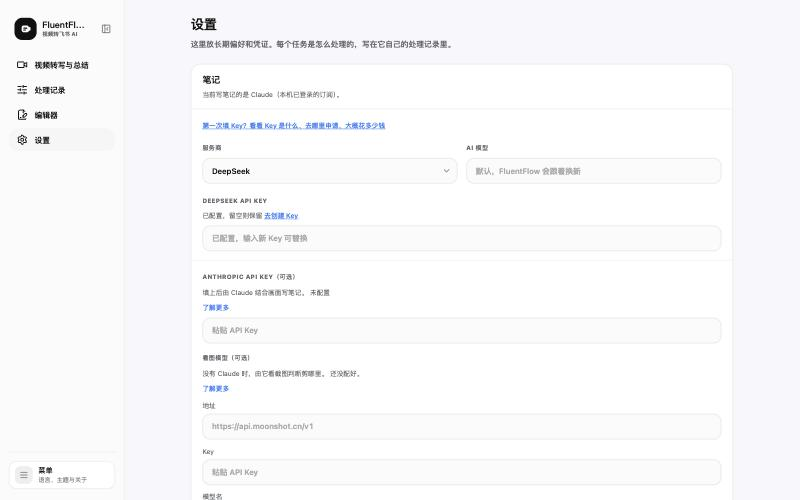
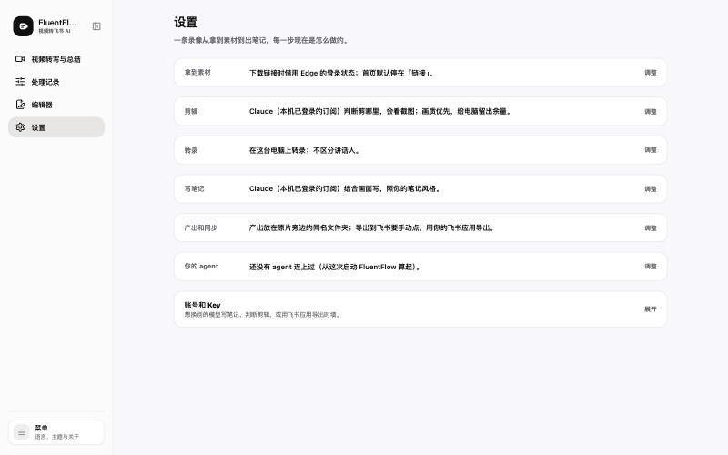
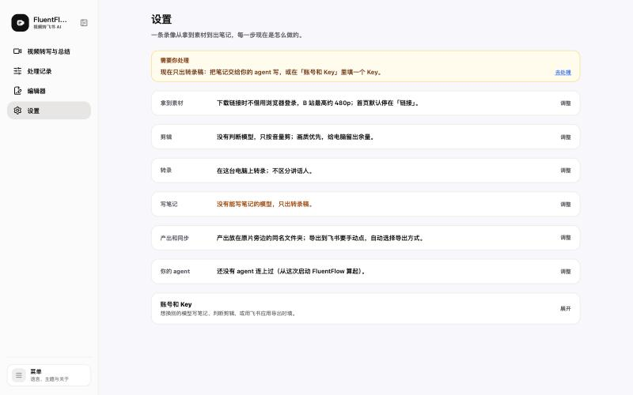
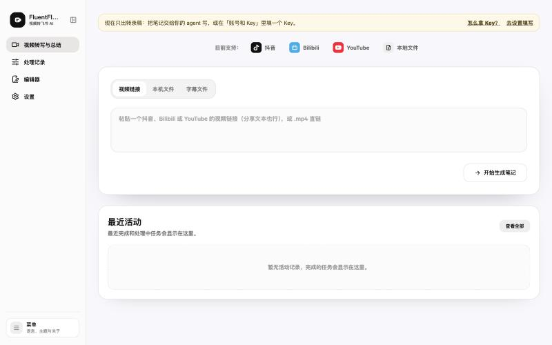

# 界面优化线三：设置和接入

- 需求：[界面优化清单](../方案/2026-10-22-界面优化清单.md)「线三」；整页重排见决策记录 6.24
- 对话：「界面优化线三：设置和接入」，工作副本分支 `claude/gui-lane3-settings-4d7429`
- 提交：`cdfafa2`（第一批：第 2 到 7 条、第 9 条一部分、第 10 条）、`060a277`（决策 6.24）、`c5abe12`（设置页按处理步骤重排、后端现状清单、MCP `get_status`）、`8f65414`（首页提示条读同一份清单、维护手册、截图）

## 交付单

### 1. 改了什么

1. 设置页按处理步骤重排：拿到素材、剪辑、转录、写笔记、产出和同步、你的 agent，一步一行写现在谁在做、怎么做，点「调整」展开这一步的选项；有要处理的事（Claude 登录过期、没有能写笔记的模型、开了区分讲话人但组件没装好）只在那时出现在最上面，带「去处理」；各家 Key 和飞书应用凭证收进最下面的「账号和 Key」。起初在旧结构上补了一块「谁在干活」，王愉超要求按产品现在的定位重新构思，于是整页重做，定为决策 6.24（`060a277`、`c5abe12`）
2. 每一行由后端给出：`backend/core/workflow_status.py` 用处理时真正选人的那几个函数算（判断剪辑的模型、看画面写笔记的通道、文字模型的 Key、处理偏好和电脑占用的实际值、讲话人组件、已存的偏好、agent 连接），页面读 `GET /workflow-status`。写笔记的服务商、区分讲话人、人声增强、仅转录、自动导出飞书、首页默认来源这几项只存在浏览器里，由页面每次带给后端（`c5abe12`）
3. agent 端：新 MCP 工具 `get_status`，读 `GET /agent/v1/status`，按 agent 提交的任务说每一步怎么做；没有判断模型时剪辑写成由 agent 判断。SKILL.md 写了什么时候调它（`c5abe12`）
4. 首页「笔记写不了」的提示条改读同一份清单，和设置页最上面是同一句话；首页和设置页带给后端的浏览器选择放在一处（`lib/workflowStatus.js`）。原来各页自己拼这句话的两个函数删掉了（`8f65414`）
5. 清单第 2 条：服务回话前「笔记」一节只写「正在读取」，不再先显示「未配置」和多出来的通义千问 Key 栏；读取失败时写「读不到，刷新再试」（`cdfafa2`）
6. 清单第 3 条：「转录在本机完成，不需要 Key」只留在转录那一步（`cdfafa2`；重排后由各步的状态句取代）
7. 清单第 4 条：一组 Key 一个「保存」按钮，回车也保存，离开输入框不自动保存，粘了一半的 Key 不会盖掉能用的那个；看图模型三项共用一个按钮（`cdfafa2`）
8. 清单第 5 条：每项说明压到一句，细节收进「了解更多」（`cdfafa2`）
9. 清单第 6 条：服务商下拉不再标「推荐」；第一次填 Key 的引导里照旧推荐通义千问（`cdfafa2`）
10. 清单第 7 条：导出记录拿出设置页；处理记录页要不要列导出过的飞书文档，归线一第 13 条（`cdfafa2`）
11. 清单第 8 条：不另做。试过页面顶部一排跳转标签，王愉超指出它占了最显眼的位置却不常用，去掉；重排后每步默认一行，整页一屏看完（`c5abe12`）
12. 清单第 9 条：在这台电脑上打开「Agent 接入」不用填访问令牌（MCP 服务和检查脚本都从 `.env` 读），只有从别的设备打开才显示令牌栏；新接口 `GET /agent-access/status` 报这次启动以来有没有 agent 连上，带浏览器请求头的不算；设置页「你的 agent」一行就是这个状态，点「调整」是接入面板，左下角菜单的入口保留（`cdfafa2`、`c5abe12`、`8f65414`）
13. 清单第 10 条：「版本更新」页去掉更新记录文件的位置，带环境变量名的句子不显示（同一条里别的句子照常显示），「最后更新」不早于最新一条带日期的记录（`cdfafa2`）
14. 指向旧位置的提示文字都改成「账号和 Key」：后端缺 Anthropic Key 的报错、整理笔记风格的报错、飞书凭证的两条诊断，前端首次填 Key 引导、笔记说明、飞书路线提示；其中 `lib/format.js`（线一的文件）里两处飞书凭证提示只改了文字，对应测试一起改（`c5abe12`）

### 2. 怎么验证的

- 每次推 main 前跑了项目要求的全部检查。最后一次（`8f65414` 前）：前端代码检查 0 个错误，6 条警告是原有的；前端 57 个测试文件 538 条全过（之后补的「agent 状态只说一次」测试另跑过，设置页和接入面板 49 条全过）；构建通过；后端 ruff 通过；后端整套 1696 条通过、3 条跳过（`c5abe12` 前跑）。
- 测试按需求写：服务回话前不说 Key 配没配、读取失败照实说、Key 只在点保存或回车时一起存、每一步按后端给的顺序和句子显示、页面把浏览器里的选择带给后端、要处理的事列在最上面并能跳到对应位置、`#notes` 打开「账号和 Key」；后端判断剪辑写的是处理时真正选中的模型、环境变量覆盖的处理偏好照实报、Claude 登录过期和没有写笔记的模型列为要处理、仅转录不算问题、agent 来问时剪辑写由 agent 判断、`/agent/v1/status` 要令牌。
- 真实界面：在工作副本里另起后端（8013 端口，任务记录用空的临时目录，设置文件用他那份的副本，看完删了），1440×900 浅色下看过：
  - 用他的真实设置：每一行都是本机 Claude 订阅在判断剪辑、写笔记；在页面上改处理偏好，那一行当场变；`/agent/v1/status` 读到的和页面一致。
  - 什么都没配的样子：设置页最上面出现「需要你处理」，写笔记那一行变成提醒色；首页顶部出现同一句提示。
  - 「你的 agent」一步展开后是接入面板，状态句只出现一次。
- 截图：
  - 重排前（第一批改完时）：
  - 重排后，他的真实设置：
  - 什么都没配时的设置页：
  - 什么都没配时的首页：

### 3. 没做的、没验证的

- 8000 上的服务还是旧代码，他的真实页面要等主仓库拉到最新、服务重启后才换成新设置页。我没有重启：主仓库目录不归这个工作副本管，那里不一定是最新的 main。新页面只在 8013 上看过。
- 有 agent 真正连上时的状态句只在 8013 上用 curl 带令牌请求过一次（`/agent/v1/status` 写「已有 agent 连上」），没在网页上看到过，因为 8013 上没有真的 agent 在用。
- 暗色模式、窄窗口、英文界面没看，清单把它们放在最后统一视觉那一轮。
- 后端的英文状态句只在测试里核过有值，没在英文界面上看过。
- 原始的、线三动手前的设置页没截图，「重排前」那张是第一批改完时的样子。

### 4. 经验

- 只关 FluentFlow：设置项一部分存在后端（Key、处理偏好、电脑占用、浏览器登录、飞书路线和文件夹），一部分只存在浏览器里、每次提交才带给后端（写笔记的服务商和模型、区分讲话人、人声增强、仅转录、自动导出飞书、首页默认来源）。所以后端清单要由页面带上浏览器里的选择再算，agent 来问时按 agent 提交的默认算。已写进决策记录 6.24 和 `backend/core/workflow_status.py` 开头的说明。
- 只关 FluentFlow：在工作副本里另起后端看新接口的做法，以及它照样会读主仓库 `.env` 和他环境里的 Key、要看「什么都没配」得把这些显式设空。已写进 `docs/04-维护手册.md` 开头看界面那一段。
- 只关 FluentFlow：脚本里单独调 `cut_judge` 时，如果 `.env` 还没加载，判断剪辑和写笔记会选出不同的通道；服务启动时会先加载，所以只影响脚本和测试。状态清单在计算前自己加载 `.env`，注释写在代码里。
- 跨项目：王愉超纠正过一次。他要的是按产品现在的定位重新构思设置页，我先是在旧结构上补了一块「谁在干活」。改一个页面的结构之前，先问这个页面现在的作用是什么、按什么组织，再决定是改还是重做，不在旧的分类上加块。
- 跨项目：王愉超纠正过一次。为第 8 条在页面头部放了一排跳转标签，他指出低频的导航占了最重要的位置。头部只放每次打开都要看的东西，跳转这类低频功能先看页面变短后还需不需要。
- 跨项目：好几个界面都要说「现在谁在做某件事」时，由后端用实际执行时选人的那套函数给出一份清单，各界面和 agent 都读它，前端不再各自推一遍规则。这次就是首页和设置页各推一遍，句子不一样。
- 跨项目：测试里给后端做替身时，替身要照真实规则答。这次首页测试的替身起初「有任何一个 Key 就算能写笔记」，真实规则只认选中的服务商的 Key，替身错了，测试也会跟着放过错的页面。

### 5. 要王愉超拍板的事

写笔记用哪家服务商、区分讲话人、处理完自动导出飞书，现在只存在浏览器里，agent 提交的任务用不上这些选择（agent 的任务按第一家有 Key 的服务商写、不区分讲话人、不自动导出）。要不要像浏览器登录和飞书路线那样存进后端，让网页和 agent 提交的任务走同一套选择？我倾向存进后端，否则同一台电脑上两种提交方式的结果会不一样。
