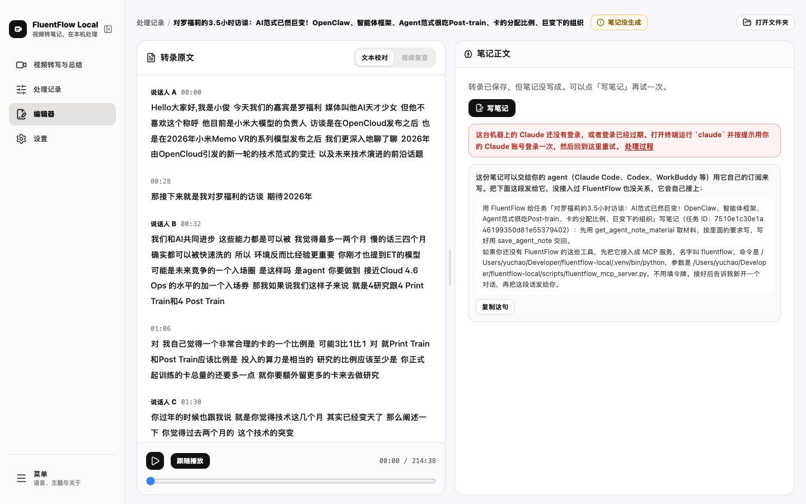
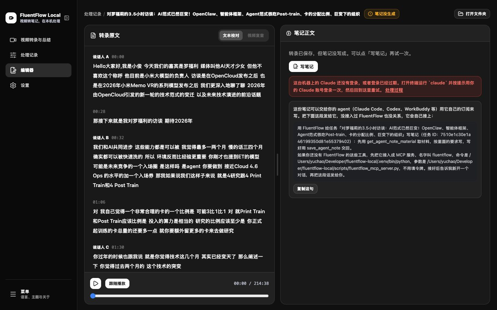
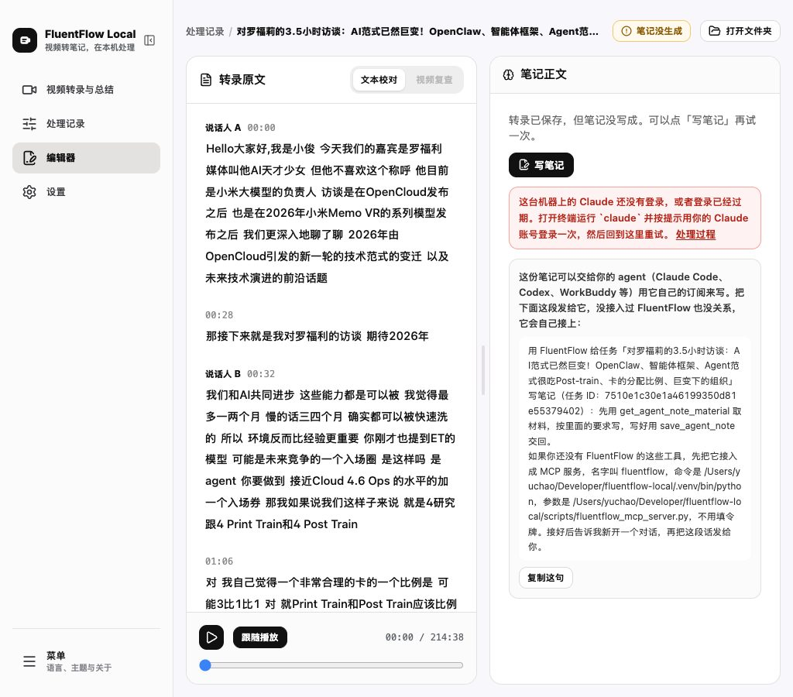
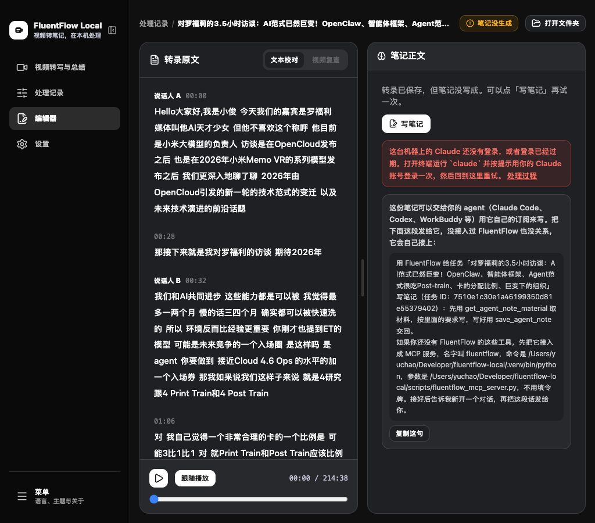
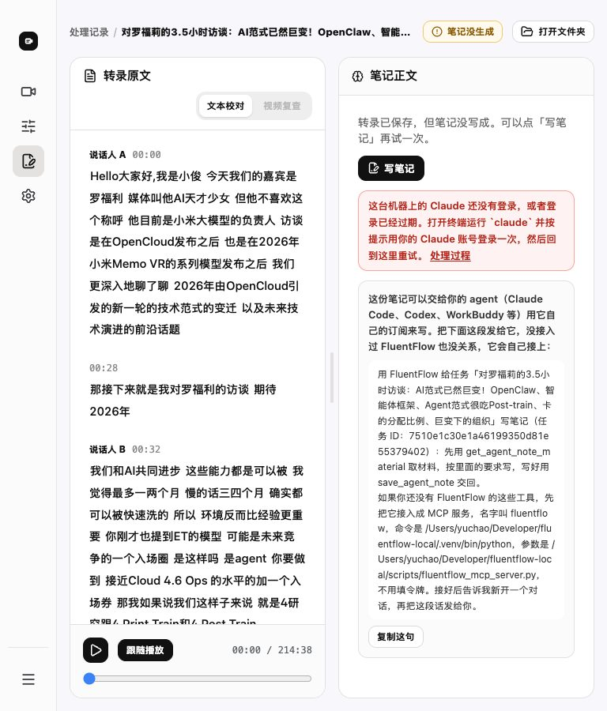
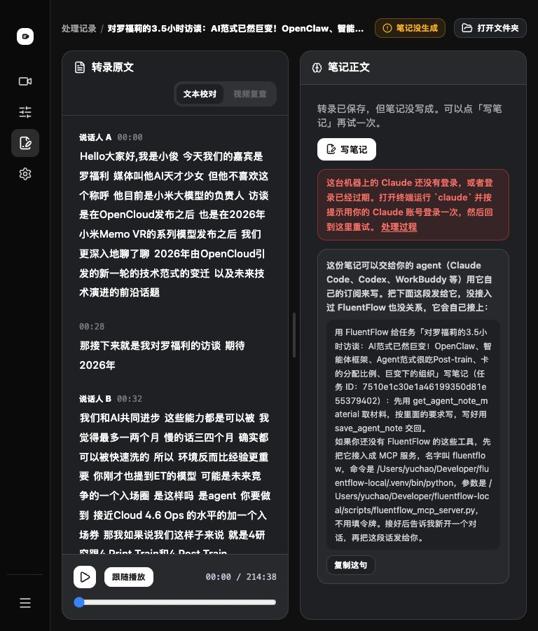

# 界面统一视觉和界面规矩（2026-10-23）

界面优化清单 [「最后统一做」](../方案/2026-10-22-界面优化清单.md) 一节，加上决策 8.6 里 FluentFlow 自己的界面规矩：写成项目文档，能让机器查的写成前端测试。决策 8.7。

## 1. 改了什么

提交：`3b67c60`（统一视觉、规矩文档、测试），交付记录这一次提交另记。

对应清单「最后统一做」第 1、2、3 条，线二留下的两处（「打开文件夹」只剩图标、笔记失败红框文字太长），线一第 18 条留下的「选中和悬停分不开」。

- 按钮和卡片样式只写在 `frontend/src/lib/ui.js`：动作按钮分主、次、弱、危险四级，高 28、32、40 像素三档，圆角 10 像素；切换、筛选、侧边栏、菜单项、工具栏、整行可点、时间戳、信息小块、拖放区各一个写法。原来一百多个按钮各写各的，圆角有十几种。
- 卡片圆角 16 像素、不加阴影，只有对话框和菜单这类浮层有阴影。
- 标题字体修好：标题写的是产品没带的 Manrope，实际全部显示成衬线体。改成和正文同一套（Inter 加系统中文无衬线）。
- 字号收档：页面标题 20 像素，空状态主句 18 像素，区块标题最大 16 像素。处理详情页、设置页、关于页、Agent 接入面板原来的 22 到 30 像素都收进来。
- 暗色模式：`text-white/62` 这类透明度 Tailwind 不生成，处理记录的信息小块、剪辑说明的灰字在暗色下几乎看不见。改成有的档。抖音图标在暗色下消失，也修了。
- 侧边栏写全名「FluentFlow Local」，副标题「视频转笔记，在本机处理」；选中的导航项底色更深、字加粗，悬停只浅浅一层；左下「菜单」去掉卡片框，和导航项一样。
- 编辑页顶部「打开文件夹」带上文字；笔记没写成时红框只留原因和怎么处理两句。
- 首页：「开始生成笔记」改成深色主按钮，「最近活动」去掉说明句，「目前支持」里的「本地文件」改「本机文件」。
- 用词：「本地视频文件」「本地转写」改「本机视频文件」「本机转录」；处理过程页的「STT」「Chapter Coverage 证据表」改中文；一处兜底标题 `Untitled` 改「未命名任务」。关于页去掉和侧边栏重复的「返回开始处理」。
- 规矩文档 [06-界面规矩](../06-界面规矩.md)：用词、各种量由哪个函数写、按钮分级和尺寸、颜色、卡片圆角、字号、宽度档；`AGENTS.md` 加了一节指向它。
- 测试 `frontend/src/ui-rules.test.js`，七条：按钮样式来自 `ui.js`、透明度有效、圆角不超过 16 像素、时长只由 `fmtDuration` 写、中文界面没有英文占位、每个界面文字都有中文、不出现「本地文件」这类说法。
- 只读预览 `vite.preview-records.config.mjs` 引用了一个没提交过的配置文件，起不来；改成自带代理，写请求照旧一律拒绝。

## 2. 怎么验证的

- 前端 lint：退出码 0，0 个错误（5 个警告是原来就有的 hook 依赖提示）。
- 前端测试：退出码 0，59 个文件 585 条全过（2026-10-24 rebase 到最新 main 后重跑）。
- 前端构建：退出码 0。
- 规矩测试反向验证：在 `routes/about.jsx` 里同时写进自带样式的按钮、`text-white/62`、`rounded-[24px]`、`Loading...`、手拼的「秒」、「本地文件」，六条测试各自失败并指到那一行；在界面文字表里加一个只有英文的键，「每个界面文字都有中文」失败。改回后全过。
- 走查：只读预览连 8000 的真实数据，首页、处理记录、处理详情、编辑页（笔记正常和笔记没写成两条任务）、设置页、关于页，在 1440、1024、768 下浅色走一遍，1440、1024、768 下暗色看了编辑页、处理记录、首页、设置页、处理详情。

三档宽度截图（编辑页，笔记没写成的那条任务）：

| 宽度 | 浅色 | 暗色 |
| --- | --- | --- |
| 1440 |  |  |
| 1024 |  |  |
| 768 |  |  |

前后对比：

- [侧边栏](../images/2026-10-23-统一视觉-对比-侧边栏.jpg)
- [首页](../images/2026-10-23-统一视觉-对比-首页.jpg)
- [编辑页笔记没写成](../images/2026-10-23-统一视觉-对比-编辑页笔记没写成.jpg)
- [处理记录暗色](../images/2026-10-23-统一视觉-对比-处理记录暗色.jpg)
- [设置页](../images/2026-10-23-统一视觉-对比-设置页.jpg)

## 3. 没做的、没验证的

- 处理详情页顶部仍是后端的整段诊断文字，下面还写着产出文件夹的完整路径：那是排查用的页面，不在这一轮清单里，按规矩 1 压缩可以另做。
- 英文界面没有逐页走查：只看了中文界面，英文那边只经测试确认每个键都在。
- 对话框（写笔记确认、修改记录、剪辑说明、中断任务）和 Agent 接入面板改了样式，但没在真实界面里一个个打开截图，只靠测试和构建。
- 视频复查模式、双语字幕视图在三档宽度下没单独看：当前真实任务里没有双语字幕的。

## 4. 这次得出的经验

- 只关 FluentFlow，已写进项目文档：
  - 按钮、卡片样式只在 `lib/ui.js`，加按钮从那里取，测试会拦自带样式的。写在 [06-界面规矩](../06-界面规矩.md) 和 `AGENTS.md`「Interface rules」。
  - 暗色模式的截图要先往浏览器本地存储写 `theme: "dark"`，命令行无头截图设不了，用 Playwright 驱动本机 Chrome。写在 [04-维护手册](../04-维护手册.md)「看界面改动」那段。
- 跨项目（留给主对话处理）：
  - Tailwind 3 的透明度只认刻度上的值（5 的倍数）或方括号写法，`text-white/62` 不报错也不生成样式，暗色下文字静默退回别的颜色。可以写成一条扫描源码的测试守住。
  - 字体只写一个没加载的名字、后面不跟通用字体族，浏览器退到默认衬线体，看起来像「设计用了宋体」，很难被当成 bug。字体栈末尾要有 `sans-serif`。
  - 要「按钮只用定下的几种样式」，做法是把样式收进一个模块，再写一条扫源码的测试：每个按钮的 className 必须引用这个模块，旁边只许加布局类。比约定好用，新按钮写错会直接失败。

## 5. 要王愉超拍板的事

已定（2026-10-24 王愉超看过前后对比图：「统一视觉那 4 处都可以」）：

1. 侧边栏写「FluentFlow Local」，副标题「视频转笔记，在本机处理」。
2. 左下「菜单」去掉卡片框，和导航项一样。
3. 首页「最近活动」去掉说明句，「开始生成笔记」改成深色主按钮。
4. 笔记没写成时红框只留原因和怎么处理两句。

还要他定的：

- 处理详情页顶部的整段诊断文字和产出路径要不要按同样的规矩压成两句？我倾向压：这页从编辑页「处理过程」点进来的人也会看，路径已经在「打开文件夹」的悬停提示里。
